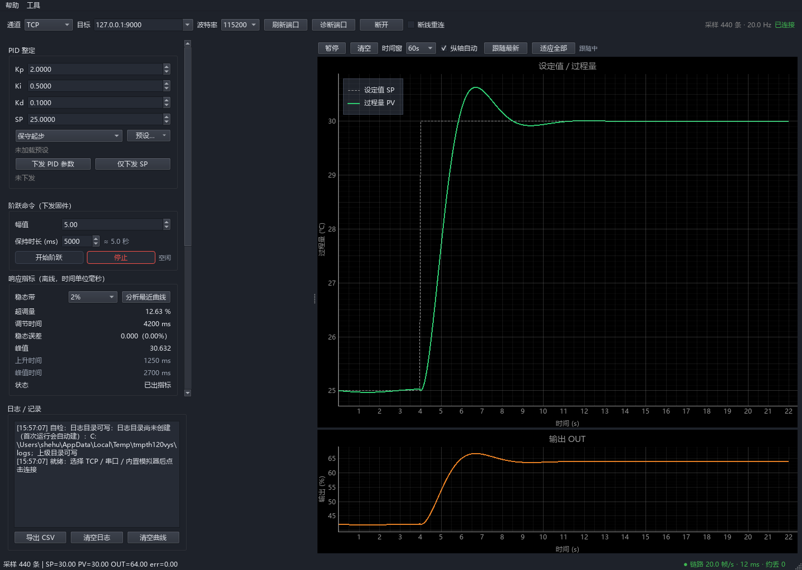
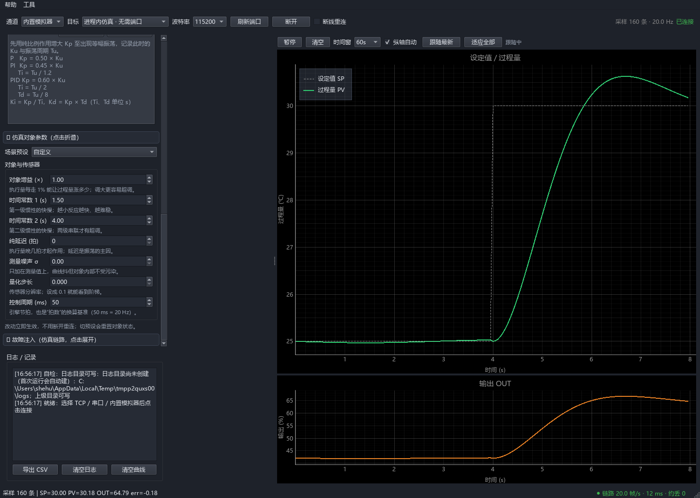

# SerialPID-Tuner

<p align="center">
  
  
</p>

开源串口 PID 调试上位机 + 配套 STM32 固件：PySide6 + pyqtgraph + pySerial 上位机，
经二进制串口协议与 MCU 通信，支持实时曲线、PID 参数下发与回显、阶跃响应测试、
Ziegler-Nichols 辅助整定、CSV 曲线导出；MCU 侧提供零 HAL 依赖的协议层 / PID 算法层 /
应用层，以及 STM32 HAL 集成示例。

> 协议字节布局已冻结，见 [`docs/PROTOCOL.md`](docs/PROTOCOL.md)（v1.0）。
> 当前版本：**0.2.1**（离线闭环 + 内置模拟器体验版）：PC 全链路、内置模拟器与
> 帮助 / 引导齐备，MCU 主机侧离线测试通过，STM32H750 可烧录 HAL 工程已入库；
> 实物首联按 [`docs/bringup.md`](docs/bringup.md) 单独验，结果未回填前不算已验证。
> 版本号的唯一来源是 `pc/serialpid/__init__.py` 的 `__version__`，本行与
> [`docs/CHANGELOG.md`](docs/CHANGELOG.md)、exe 文件属性都由它派生。
> 不知道该读哪篇文档时，从 [`docs/INDEX.md`](docs/INDEX.md) 进。

## 功能

- **稳定通信**：串口（115200 8N1）/ TCP 双传输抽象；粘包、拆包、错帧、坏 CRC、
  超长帧自动重同步；空闲超时 1.0 s 判定断流并回调链路状态。
- **通信可靠性**：主动心跳（默认 1 s，连续 3 次无应答且无帧才判死）、链路质量灯
  （帧率 / RTT / 约丢 / 坏帧占比）、八类断线原因分类、可选自动重连（默认关）、
  2000 帧环形日志与回放（文本 / JSONL、0.5×–10× 倍速）。心跳与判死次数可在
  「工具 → 链路设置…」里改，立即生效并写入 `config.json`。
- **实时绘图**：SP / PV / OUT 同屏滚动，误差随行记录。
- **参数下发**：Kp / Ki / Kd / SP 经 `PID_SET` 下发，固件回 `PID_ACK` 回显并确认；
  NaN / Inf / 越界参数拒绝并回错误码；参数预设可保存 / 加载 / 删除 / 重命名。
- **阶跃测试**：上位机配置幅值与保持时长，自动辨识超调量、峰值 / 峰值时间、
  10%–90% 上升时间、调节时间（1% / 2% / 5% 稳态带）、稳态误差。
- **Z-N 辅助整定**：临界振荡法 / 反应曲线法两套经典公式，纯 PC 侧计算，
  选定后经既有 `PID_SET` 帧下发。
- **日志导出**：遥测曲线导出 CSV（UTF-8 带 BOM、六位小数，Excel 直开）；
  日志面板在内存保留最近事件记录。
- **内置模拟器**：选「内置模拟器」即连，无需另开进程；8 个场景预设（快速小惯性、
  慢速大惯性、大延迟、带噪声、大增益易振荡、执行器饱和、粗糙量化、纯延迟主导），
  7 项对象参数改动即时生效，可注入丢帧 / 坏帧 / 强制断线（只注入下行）。
- **外部模拟器**：需要走真实 socket 时，用 TCP 模拟器（一阶惯性植物 + 简易 PID）
  跑通全流程。
- **端口与启动诊断**：端口三态枚举（有设备 / 无设备 / 枚举失败，带超时保护，
  可粘贴诊断文本）；启动八项自检 + 失败 / 警告横幅，`--selftest --json --out`
  供无控制台 exe 取结果。
- **上手不靠猜**：F1 内置帮助（内容与用户手册同源）、首启三屏向导、关于框里能
  复制诊断信息；所有失败提示统一成「现象 / 原因 / 下一步」三段式。
- **整定与验证工具**：`tools/sweep_params.py` 批量扫 Kp / Ki 并标振荡临界点；
  `tools/replay_frames.py` TCP 回放帧记录；`tools/pressure_test.py` 长稳压测；
  `tools/bringup_check.py` 把上板八步落成一条命令。
- **真机工程**：`mcu/h7_board/` 为 STM32H750VBT6 可烧录 HAL 工程（`build.ps1` /
  `flash.ps1`），上板流程与判据见 [`docs/bringup.md`](docs/bringup.md)。
- **深色主题**：内置统一配色的深色界面，曲线颜色与面板配色集中在 `gui/theme.py`。

## 快速开始

### 零硬件三步看到曲线（推荐）

不需要接线、不需要驱动、不需要第二个终端：

1. **打开程序**：双击 `SerialPID-Tuner.exe`（或按下面的「源码运行」启动）；
2. **选内置模拟器**：「通道」下拉选 **内置模拟器**，目标自动变成
   「进程内仿真 · 无需端口」；
3. **点连接**：按钮变成「断开」、状态显示「已连接」，曲线开始滚动。

完整练习路径（选预设 → 改参数 → 打阶跃 → 读指标 → 注入故障 → 恢复直通）见
[`docs/user_guide.md` 第 4 章](docs/user_guide.md#4-内置模拟器调参实战)。


### 源码运行（开发 / 调试）

要求 Python 3.10+（开发环境实测 3.13）。

本机开发环境建在**仓库的上一层**（`串口PID/.venv`，依赖已装好），从仓库根直接激活：

```powershell
# 仓库根目录
..\.venv\Scripts\activate          # Windows；Linux/macOS: source ../.venv/bin/activate
```

干净克隆或想自建环境时，虚拟环境位置不限，建好激活后安装依赖即可：

```powershell
python -m venv .venv
.venv\Scripts\activate
pip install -r pc\requirements.txt
```

启动上位机（在 pc/ 目录下以模块方式运行）：

```powershell
cd pc
python -m serialpid.main
```

### 备选：外部 TCP 模拟器（无需硬件）

需要"像真实设备一样从 socket 里收帧"时用这条路径；日常体验直接用内置模拟器更省事。

```powershell
# 终端 1：启动 TCP 模拟器（默认 127.0.0.1:9000）
python tools\fake_mcu.py --port 9000

# 终端 2：启动上位机，连接方式选 TCP，地址 127.0.0.1:9000
cd pc
python -m serialpid.main
```

### 打包发行版

Windows（[`scripts/build.bat`](scripts/build.bat)）：

```powershell
scripts\build.bat
# 产物：dist\SerialPID-Tuner-v0.2.1.exe（单文件、无控制台、带图标与版本信息）
#       dist\SerialPID-Tuner.exe（稳定名副本，供文档引用）
```

Linux / macOS（[`scripts/build.sh`](scripts/build.sh)）：

```bash
bash scripts/build.sh            # 正常打包
bash scripts/build.sh --check    # 只查打包前条件（依赖 / 图标 / 版本）
bash scripts/build.sh --dry-run  # 打印将执行的命令，不实际打包

# 产物（Linux）：dist/SerialPID-Tuner-v0.2.1-linux-x86_64.tar.gz
#                （onedir：可执行文件 + _internal + .desktop + udev 规则 + 首次运行说明）
# 产物（macOS）：dist/SerialPID-Tuner-v0.2.1-macos-arm64.zip
#                （SerialPID-Tuner.app + 首次运行说明，图标取自 assets/app.icns）
```

**PyInstaller 不能交叉打包**：Linux 包必须在 Linux 上打、macOS 包必须在 macOS 上打。
三平台打包由 CI 的 `package` 矩阵负责（见 [`.github/workflows/ci.yml`](.github/workflows/ci.yml)），
打 tag 时同一次流水线会把三份产物挂到 Release 页。平台差异、已知坑与验证边界见
[`docs/PACKAGING.md`](docs/PACKAGING.md)。

打包依赖见 [`pc/requirements-dev.txt`](pc/requirements-dev.txt)：PyInstaller / Pillow /
pytest 均**锁定版本**，脚本用 `pip install -r` 安装而不是裸装，保证同一份源码换个时间
打出来的包一致。版本号取自 `pc/serialpid/__init__.py` 的 `__version__`，打包脚本会先把
`scripts/version_info.txt` 重新生成一遍——exe 属性里的版本不会落后于源码。

构建脚本会优先使用项目环境（`../.venv`）里的解释器，找不到才回退 `PATH` 中的 `python`，
并在日志第一行打印实际使用的解释器路径；依赖已装好时跳过安装，不污染全局环境。

### 下载与安装（给最终用户）

正式发行版放在 GitHub Release 页（每次打 tag 由 CI 自动上传三平台产物 + 发布报告）：

| 平台 | 下载物 | 第一次运行 |
| --- | --- | --- |
| Windows 10/11 | `SerialPID-Tuner-v<版本>.exe` | 双击即可，无需装 Python；SmartScreen 提示时选「更多信息 → 仍要运行」 |
| Linux x86_64 | `SerialPID-Tuner-v<版本>-linux-x86_64.tar.gz` | `tar xzf ... && ./SerialPID-Tuner/SerialPID-Tuner`（保持目录结构，`_internal/` 不能拆走） |
| macOS | `SerialPID-Tuner-v<版本>-macos-<arch>.zip` | 解压后把 `.app` 拖进「应用程序」；首次打开需右键 →「打开」绕过 Gatekeeper |

每个 Release 附 `SHA256SUMS.txt`，可本地校验：

```bash
sha256sum -c SHA256SUMS.txt        # Linux
shasum -a 256 -c SHA256SUMS.txt    # macOS
certutil -hashfile SerialPID-Tuner-v0.2.1.exe SHA256   # Windows
```

**Linux 串口权限（普通用户必看）**：默认只有 `dialout` 组能读写 `/dev/ttyUSB*`，
不在组里会报"权限不足 / Permission denied"。把自己加入该组后**重新登录**：

```bash
sudo usermod -aG dialout "$USER"
# 退出登录再进入（或 newgrp dialout）才生效
groups "$USER"        # 应能看到 dialout
```

个别发行版的 `uaccess` 规则不覆盖 CH340/CP210x，可另装 udev 规则
（打包目录里的 `serialpid-udev.rules`，或手册
[`docs/user_guide.md`](docs/user_guide.md) 的「Linux 串口权限」一节）。

缺 `libGL.so.1` / `libEGL.so.1` 时（最小化安装的发行版）先补运行库：

```bash
sudo apt install -y libgl1 libegl1 libxkbcommon0 libdbus-1-3   # Debian/Ubuntu
sudo dnf install -y mesa-libGL mesa-libEGL                     # Fedora
```

### 发布（测试 → 自检 → 打包 → 校验 → 冒烟 → 报告）

```powershell
..\.venv\Scripts\python.exe scripts\release.py
# 报告归档：docs\releases\v<版本>.md（版本 / commit / 构建源 / 测试结果 / 产物 SHA-256）

# 工作区里还有别人的未提交改动时，从 HEAD 的干净副本构建：
..\.venv\Scripts\python.exe scripts\release.py --clean-tree
```

> `--allow-dirty` 只用于排障：它会直接用当前工作区打包，产物不保证与任何提交
> 一一对应，不要写进发布记录。正常发布只用 `--clean-tree`。

发布脚本**不自动打 tag、不自动上传**：变更日志与截图由人确认后再发。
打了 tag 之后，CI 的 `release` job 会用 `scripts/make_release_body.py` 把
`docs/releases/v<版本>.md` + 三平台下载表合成 Release 附注并挂载产物。
只想查"产物有没有落后源码"时单独跑：

```powershell
..\.venv\Scripts\python.exe scripts\check_artifact_freshness.py --require
```

## 测试

### PC 侧离线测试

```powershell
cd pc
python -m pytest tests/ -q
```

覆盖：协议编解码与 CRC 标准向量、TCP 自收发闭环、阶跃分析、Z-N 整定、
模拟器集成闭环、GUI 离屏冒烟。

### MCU 侧主机测试（无需开发板 / 无需 HAL）

协议层与 PID 算法层零 HAL 依赖，可在主机用 gcc 直接编译运行，真值来自 PC 侧冻结协议：

```powershell
# Windows（MinGW gcc）
pwsh mcu\test\run_host_test.ps1

# 或手动编译
cd mcu\test
gcc -std=c11 -Wall -Wextra -I../Inc -I. host_test.c     ../Src/pid_comm.c ../Src/pid_calc.c     -o host_test.exe
gcc -std=c11 -Wall -Wextra -I../Inc -I. app_host_test.c ../Src/pid_comm.c ../Src/pid_calc.c ../Src/pid_app.c -o app_host_test.exe
.\host_test.exe
.\app_host_test.exe
```

黄金向量由 PC 协议实现生成，改动协议后重新生成：

```powershell
python tools\gen_protocol_vectors.py
```

## 仓库结构

```
SerialPID-Tuner/
├── LICENSE                      # MIT 许可证
├── pc/                          # 上位机
│   ├── main.py                  # 薄启动器（PyInstaller 入口）
│   ├── requirements.txt         # 运行依赖
│   ├── requirements-dev.txt      # 开发 / 打包 / 测试依赖
│   ├── tests/                    # 离线单测 + GUI 离屏冒烟 + 模拟器集成
│   └── serialpid/
│       ├── protocol.py           # 冻结协议编解码 / CRC / 载荷封解包
│       ├── transport.py          # Serial / TCP 传输抽象
│       ├── comm.py              # 通信线程核心
│       ├── comm_qt.py            # Qt 信号适配
│       ├── model.py              # 参数 / 采样 / 环形缓冲
│       ├── step_test.py          # 阶跃响应分析 + 自动测试状态机
│       ├── zn_tuning.py          # Z-N 整定公式与反应曲线辨识
│       ├── csv_export.py         # CSV 导出
│       ├── config.py             # 参数输入范围配置（config.json 读写与回落）
│       ├── messages.py           # 统一提示文案：现象 / 原因 / 下一步三段式
│       ├── frame_log.py           # 未知类型帧聚合计数日志
│       ├── link_stats.py          # 链路质量统计（帧率 / RTT / 丢帧 / 坏帧占比）
│       ├── preset_manager.py     # PID 预设 JSON 管理
│       ├── port_scan.py          # 串口端口三态诊断（超时保护 + 可粘贴诊断文本）
│       ├── selftest.py           # 启动自检与依赖诊断（八项三态报告）
│       ├── sim/                  # 进程内仿真：植物 / 协议会话 / 传输 / 参数 / 预设 / 故障注入
│       │   ├── presets.py        # 8 个场景预设 + "对应什么真实对象"的一句话说明
│       │   └── degradation.py    # 下行丢帧 / 坏帧 / 强制断线注入
│       └── gui/                  # 主窗口 / 曲线 / 参数 / 阶跃 / Z-N / 日志 / 仿真面板
│           ├── link_settings.py   # 链路设置：心跳开关 / 间隔 / 判死次数 / 统计清零
│           ├── link_status.py     # 状态栏链路质量灯
│           ├── fault_panel.py     # 故障注入折叠区
│           ├── frame_log_dialog.py # 帧日志列表 / 导出 / 回放
│           ├── help_dialog.py     # F1 帮助（从 user_guide.md 抽三节渲染）
│           ├── about_dialog.py    # 关于框：版本 / 依赖 / 许可证 / 复制诊断
│           └── onboarding.py      # 首次运行三屏向导（可跳过、只弹一次）
├── mcu/                         # 固件（协议层 / 算法层 / 应用层 + HAL 示例）
│   ├── Inc/  Src/
│   │   ├── pid_comm.*            # 协议解析 / 组帧 / CRC / 环形缓冲（无 HAL）
│   │   ├── pid_calc.*            # 位置式 / 增量式 PID、抗饱和、微分先行（无 HAL）
│   │   ├── pid_app.*             # 帧分发 / 控制节拍 / 遥测 / 阶跃 / 掉电保存（无 HAL）
│   │   ├── main_example.c        # STM32 HAL 接线示例（UART 中断 + 时基 + PWM 占位）
│   │   └── pid_nvm_stm32_example.c  # Flash 参数保存示例（F1/F4/H7 分支）
│   ├── h7_board/                 # STM32H750VBT6 可烧录 HAL 工程（build.ps1 / flash.ps1）
│   └── test/                     # 主机侧 C 测试运行器 + 黄金向量
├── tools/
│   ├── fake_mcu.py               # 外部 TCP 模拟器
│   ├── sweep_params.py           # 批量扫参：Kp / Ki 网格、振荡临界点、CSV + 汇总 md
│   ├── replay_frames.py          # 独立 TCP 回放服务（JSONL、倍速 / 循环）
│   ├── pressure_test.py          # 长稳压测（gui / tcp / reconnect 三模式）
│   ├── bringup_check.py          # 真机首联八步自动核对（--loopback / --nvm-*）
│   ├── walkthrough_35.py         # 三对话框 + 主窗口自动走查（截图 + report.json）
│   ├── gen_protocol_vectors.py   # 从 PC 协议生成 MCU 黄金向量
│   ├── make_icon.py              # 生成应用图标
│   ├── make_screenshots.py       # 离屏生成六张标准界面截图（docs/images）
│   ├── make_wiring_diagram.py    # 生成 USART1 接线示意图
│   └── make_version_info.py      # 从 __version__ 生成 Windows 版本资源
├── scripts/                      # 打包 / 发布 / 产物校验脚本与 Windows 版本资源
├── .github/workflows/ci.yml      # 五档 CI：PC / 长稳 / MCU / ARM / 出包
├── assets/                       # 图标等随包资源
└── docs/
    ├── INDEX.md                  # 文档索引（想了解什么该读哪篇）
    ├── FEATURES.md               # 功能—文档对照清单（已写 / 缺失 / 过时）
    ├── PROTOCOL.md               # 冻结协议基准 v1.0
    ├── user_guide.md             # 上位机使用手册（五分钟上手 / 模拟器调参实战 / 界面速查）
    ├── development.md            # 二次开发与分层 / 线程模型
    ├── PC_TOOLS_API.md           # PC 侧函数级接口说明
    ├── wiring.md                 # 硬件接线与 IO 回调映射
    ├── bringup.md                # 从零上电联调八步与故障排查
    ├── ITERATION.md              # 迭代路线与风险
    ├── TEST_REPORT.md            # 验收测试报告
    ├── BUGS.md                   # 已知问题与限制清单
    ├── RELEASE_CHECKLIST.md      # 发布前检查清单
    ├── images/                   # 手册与 README 引用的截图 / 示意图
    ├── releases/                 # 每版本一份发布报告（release.py 生成）
    └── CHANGELOG.md              # 变更记录
```

## MCU 移植要点

- 三个核心模块（`pid_comm` / `pid_calc` / `pid_app`）**不依赖 HAL / CMSIS / RTOS**，
  硬件差异全部经 `pid_app_io_t` 回调注入：`write_output` / `read_pv` / `send_frame` /
  `nvm_load` / `nvm_save` / `system_reset`。
- 接收路径：UART 中断（或 DMA + IDLE）只把字节推入环形缓冲；解析、控制、组帧、发送
  全部在主循环，中断内不阻塞、不打印、不等锁。
- 时间基准由调用方以毫秒传入 `pid_app_tick(app, now_ms)`；内部节拍用无符号减法，
  32 位回绕安全。
- 具体芯片型号已选 STM32H750VBT6（`mcu/h7_board/` 可编译 / 烧录）；PWM / ADC 的真实
  IO 分支目前**仅编译通过、未在实物上运行**，引脚与回调映射见 [`docs/wiring.md`](docs/wiring.md)，
  上板验证按 [`docs/bringup.md`](docs/bringup.md)。

## 路线图

- **v0.1 基础闭环**（已完成）：协议冻结、PC 通信 / GUI / 模拟器、MCU 协议与算法主机测试。
- **v0.2 离线增强与发布工程**（当前）：内置仿真面板（8 场景预设 / 故障注入）、端口诊断、
  启动自检、预设管理、心跳与链路质量、帧日志 / 回放、统一三段式提示、
  F1 帮助 / 关于 / 首启向导、标准截图与接线示意图；H750 HAL 工程、批量扫参与首联脚本；
  版本号单一来源、五档 CI、一键发布脚本与产物新鲜度判据。
- **v0.3 真机与长稳**：实物烧录联调与八步自测回填、PWM / ADC 真实 IO 验证、
  长时间长稳报告；录制回放与故障注入按实测数据再增强。

详见 [`docs/ITERATION.md`](docs/ITERATION.md)。

## 许可

本项目采用 **MIT License**，全文见仓库根目录 [`LICENSE`](LICENSE)；
Windows 版本资源（`scripts/version_info.txt`）中的 `LegalCopyright` 与之一致。

第三方依赖（PySide6 / pyqtgraph / pySerial / numpy 等）分别遵循其自身许可证。
