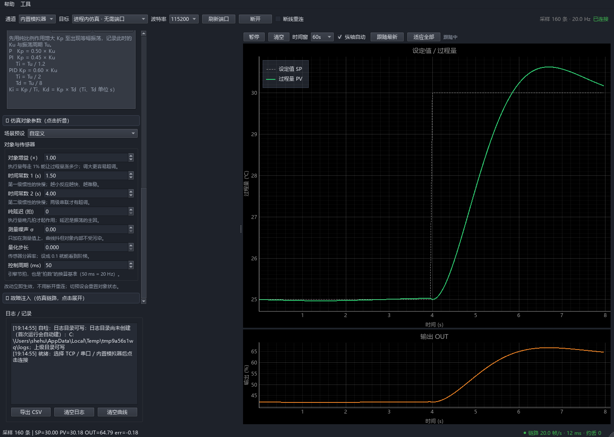
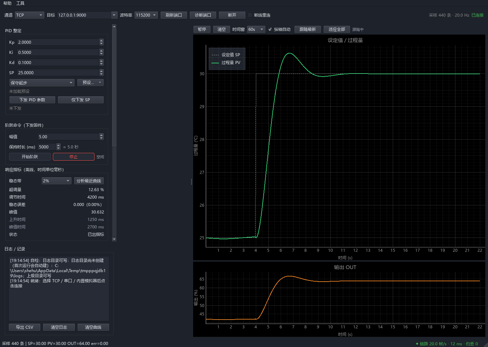
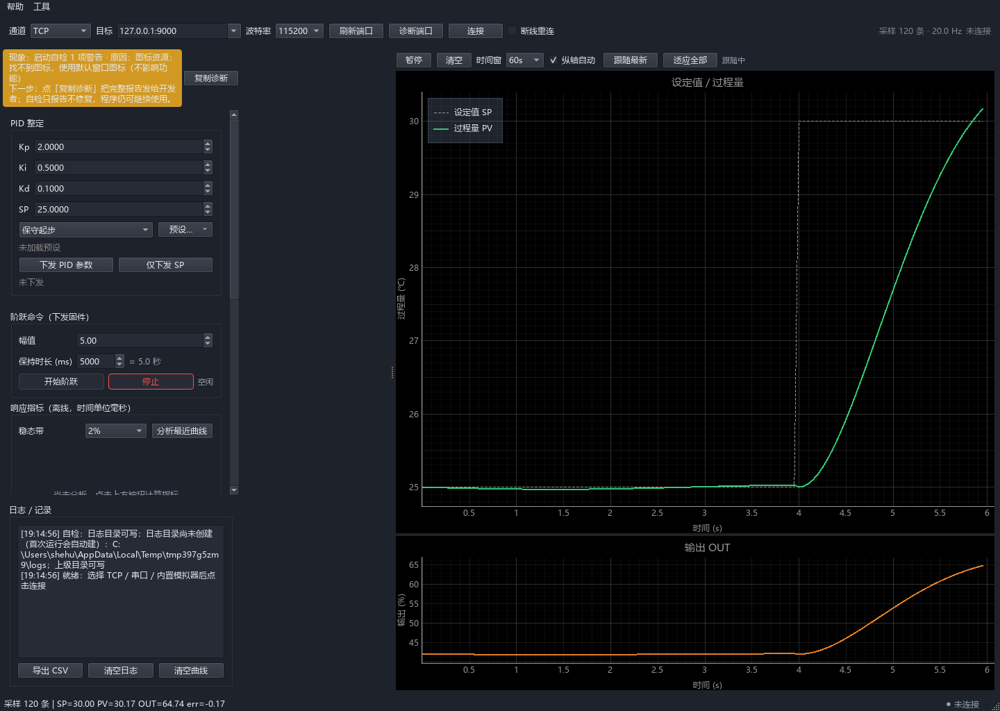
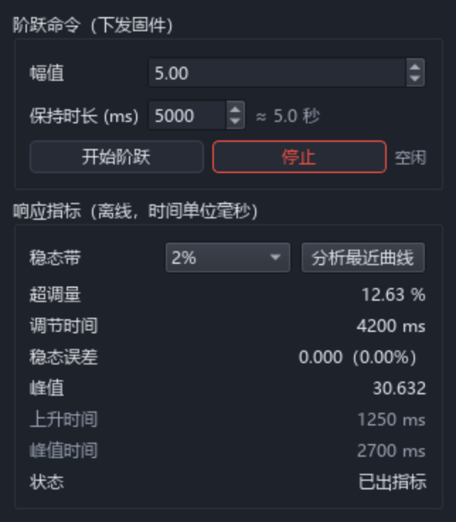
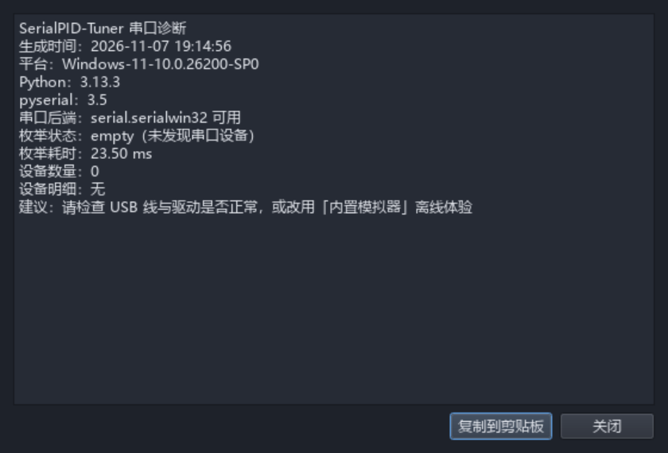
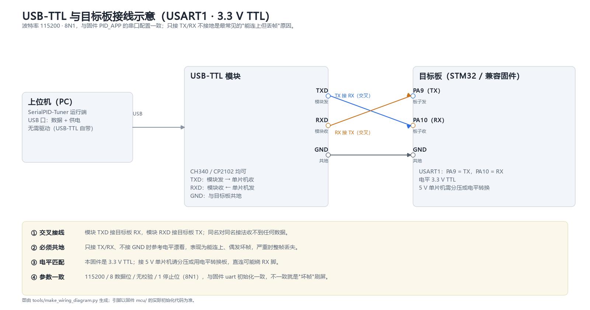

# SerialPID-Tuner 用户使用手册

> 面向上位机使用者：安装、连接模拟器 / 实物串口、阶跃测试、Ziegler-Nichols
> 辅助整定、曲线记录与导出。协议字节细节见 [PROTOCOL.md](PROTOCOL.md)，
> 二次开发接口见 [development.md](development.md)，硬件接线见 [wiring.md](wiring.md)。

## 五分钟上手

不需要接线、不需要装驱动，三步就能看到第一根曲线：

1. **打开程序**：源码运行 `python -m serialpid.main`（在 `pc/` 下），或双击
   `SerialPID-Tuner.exe`。第一次启动会弹一个三屏小向导，点「跳过」也不会再弹。
2. **选内置模拟器**：顶部「通道」下拉选 **内置模拟器**，目标会自动变成
   「进程内仿真 · 无需端口」——不用开任何外部进程。
3. **点连接**：按钮变成「断开」、右上角显示「已连接」，右侧曲线开始滚动，
   说明协议、绘图、参数整定这条链路已经全通。



> 手边有板子时把第 2 步换成 `Serial` + 串口号即可，接线与电平注意见
> [wiring.md](wiring.md)；连不上看 [端口诊断](#4-连接实物设备)。
> 卡在某一步，按 **F1** 打开内置帮助，内容就是本手册的「五分钟上手 / 界面速查 /
> 常见问题」三节。

## 1. 功能概览

- 实时曲线：设定值 SP、被控量 PV、输出 OUT、误差 err 同屏滚动。
- 参数下发：Kp / Ki / Kd / SP 经 `PID_SET` 帧下发，固件回 `PID_ACK` 确认；
  参数预设可保存 / 加载 / 删除 / 重命名。
- 阶跃测试：上位机下发阶跃命令，PC 侧离线计算超调量、峰值 / 峰值时间、
  10%–90% 上升时间、调节时间（1% / 2% / 5% 稳态带）、稳态误差。
- Z-N 辅助整定：闭环临界振荡法、开环反应曲线法两套经典公式，纯 PC 侧计算，
  不改动 MCU 固件；选定控制律后经既有 `PID_SET` 帧下发。
- 记录导出：遥测曲线导出 CSV（UTF-8 带 BOM，Excel 直开不乱码）。
- 内置模拟器：进程内闭环，8 个场景预设（快速小惯性、大延迟对象、执行器饱和等），
  7 项对象参数改动即时生效，带丢帧 / 坏帧 / 强制断线三种故障注入（第 4 章）。
- 外部模拟器：无硬件时也可以用 TCP 连接 `tools/fake_mcu.py` 跑通全流程（第 3 章）。
- 通信可靠性：主动心跳、链路质量灯、断线原因分类、可选自动重连、帧日志与回放
  （第 6 章）；端口三态诊断、启动八项自检、统一三段式错误提示。
- 上手辅助：F1 内置帮助、首启三屏向导、关于框复制诊断信息。



## 2. 环境要求与安装

### 2.1 打包版（最终用户）

发行版发布在 GitHub Release 页，按平台下载（每个包都自带 Python 与 Qt，无需另装环境）：

| 平台 | 文件 | 用法 |
| --- | --- | --- |
| Windows 10/11 | `SerialPID-Tuner-v<版本>.exe` | 双击即可；SmartScreen 提示时「更多信息 → 仍要运行」 |
| Linux x86_64 | `SerialPID-Tuner-v<版本>-linux-x86_64.tar.gz` | 解压后跑 `./SerialPID-Tuner/SerialPID-Tuner` |
| macOS | `SerialPID-Tuner-v<版本>-macos-<arch>.zip` | 解压后把 `.app` 拖进「应用程序」 |

- Windows：首次启动如被杀毒软件拦截，属单文件 PyInstaller 打包的常见误报，可加信任。
- Linux：**不要**把可执行文件单独拷出来跑，`_internal/` 必须与它同目录。
- macOS：未签名，首次打开会被 Gatekeeper 拦下——右键点图标选「打开」，或到
  「系统设置 → 隐私与安全性」点「仍要打开」。之后双击正常。

#### Linux 串口权限（普通用户必看）

Linux 默认只有 `dialout` 组的成员能读写 `/dev/ttyUSB*`、`/dev/ttyACM*`。不在组里时，
程序能启动、端口也在列表里，但一点「连接」就报"权限不足 / Permission denied"。

```bash
# 1) 把自己加入 dialout 组
sudo usermod -aG dialout "$USER"

# 2) 重新登录生效（或临时用 newgrp 开一个新 shell）
newgrp dialout

# 3) 确认生效：输出里应有 dialout
groups "$USER"

# 4) 自己能读写设备节点
ls -l /dev/ttyUSB0      # 组应为 dialout，权限 crw-rw----
```

若已加入 `dialout` 仍打不开，个别发行版的 `uaccess` 规则不覆盖 CH340 / CP210x，
装一条 udev 规则（打包目录里的 `serialpid-udev.rules` 可直接用）：

```bash
sudo cp serialpid-udev.rules /etc/udev/rules.d/99-serialpid.rules
sudo udevadm control --reload-rules
sudo udevadm trigger
# 拔插一次 USB 线
```

规则按厂商号放行常见 USB 转串口（1a86 CH340 / 10c4 CP210x / 0403 FTDI / 2341 Arduino）。
`MODE="0666"` 意味着本机所有用户可读写这些设备，单用户桌面够用；多用户机器建议改成
`GROUP="dialout", MODE="0660"`。

**缺运行库**（最小化安装的发行版常见，报 `libGL.so.1: cannot open shared object file`）：

```bash
sudo apt install -y libgl1 libegl1 libxkbcommon0 libdbus-1-3   # Debian / Ubuntu
sudo dnf install -y mesa-libGL mesa-libEGL                     # Fedora
```

**macOS 串口**：CH340 / CP210x 需装厂商驱动；若系统提示"允许配件连接"，
在「系统设置 → 隐私与安全性」里放行。

### 2.2 源码运行（开发 / 调试）

要求 Python 3.10 及以上（开发环境实测 3.13）。

本机既有环境建在**仓库的上一层**（`串口PID/.venv`，依赖已装好），从仓库根激活：

```powershell
cd SerialPID-Tuner
..\.venv\Scripts\activate          # Windows PowerShell
# source ../.venv/bin/activate     # Linux / macOS
```

干净克隆或想自建环境时，虚拟环境位置不限：

```powershell
python -m venv .venv
.venv\Scripts\activate
pip install -r pc\requirements.txt
```

启动上位机（在 `pc/` 目录下以模块方式运行）：

```powershell
cd pc
python -m serialpid.main
```

程序启动时会做八项自检（Python / PySide6 / 平台插件 / pyserial / 配置与日志目录 /
图标资源 / 协议往返）。全部通过不打扰；有警告或失败时，左上角会出现一条黄色或
红色横幅，写明「现象 / 原因 / 下一步」，横幅上的 **复制诊断** 可把整份报告贴给
维护者：



菜单「帮助 → 关于」里能看到程序版本、Python 版本、PySide6 / pyqtgraph / pyserial /
numpy 版本与许可证，并能一键复制诊断信息。

## 3. 备选离线路径：外部 TCP 模拟器

内置模拟器（五分钟上手、第 4 章）不用开第二个进程，是首选。这一节留的是另一条
路径：需要"像真实设备一样从 socket 里收帧"时，用外部 TCP 模拟器，帧格式与实物
串口完全一致。

1. 新开一个终端，启动模拟器：

   ```powershell
   python tools/fake_mcu.py --port 9000
   ```

2. 启动上位机，顶部工具栏：
   - 通道：`TCP`
   - 目标：`127.0.0.1:9000`
   - 波特率：TCP 链路忽略
3. 点击 **连接**。状态栏变为已连接，右侧曲线开始滚动，模拟器终端会打印收到的
   `PID_SET` / `SP_SET` / `STEP_START` 等命令。


模拟器面板还可以展开「仿真对象参数」，改增益 / 时间常数 / 纯延迟 / 噪声，
立刻生效，不用断开重连——用来预演"超调从哪来、延迟多大算难调"。

它下面的「故障注入」折叠区专门制造麻烦（**默认三根滑杆都是 0，即链路直通**）：

- **丢帧率（设备→上位机）**：0–50%，按比例把下行帧整帧丢掉，模拟丢包 / 从机发不全；
- **坏帧率（CRC 损坏）**：0–30%，按比例把下行帧的 CRC 改错，模拟干扰 / 波特率不一致；
- **N 秒后强制断线**：0–60 s，0 表示不断；用来演练"掉线那一刻界面说了什么、该做什么"。

滑杆在连接中拖动即刻生效，不用断开重连；点「恢复直通」一键归零。只注入下行——
上行命令也丢的话，"参数没生效"与"链路坏了"就分不清了。注入坏帧后，状态栏右侧的
「坏帧 N」会开始计数，链路质量灯变差，日志给一次三段式说明（现象 / 原因 / 下一步），
过密时会限流，不会把日志刷满。

> 模拟器植物仅用于演示链路与绘图，其 PID 整定结果不代表真实被控对象。

## 4. 内置模拟器调参实战

这一章是一条完整练习路径：**选预设 → 看曲线 → 改对象参数 → 下发 PID →
打阶跃 → 读指标 → 注入故障 → 恢复直通**。不需要接线、不需要第二个终端，
只开一个上位机窗口，5–10 分钟能走完。每一步都说明"该看到什么"，看不到就
按提示排查，别靠猜。

### 4.1 选一个像真实对象的预设

打开模拟器面板，顶部「场景预设」下拉里有 8 个预设（外加第一项「自定义」）。
每个预设是一整套对象参数，切换会整组替换并**重置对象状态**；鼠标停在预设名上
能看到它"对应什么真实对象"。

| 预设 | 像什么 | 会看到什么 |
| --- | --- | --- |
| 快速小惯性 | 小热容探头、小功率加热片 | 几十毫秒就跟着动，曲线几乎不超调 |
| 慢速大惯性热对象 | 大功率加热炉、热水箱 | 十几秒才见反应，整定周期长 |
| 大延迟对象 | 长管道、远距离测温 | 延迟约 0.5 s（10 拍），与惯性同量级 |
| 带噪声传感器 | 廉价热电偶加长线干扰 | 曲线上有毛刺，读数最小分辨约 0.05 |
| 大增益易振荡 | 高放大倍数执行器 | Kp 略大就等幅振荡 |
| 执行器饱和 | 大惯性对象配小执行器 | 输出很快顶到 0 或 100，积分饱和后回不来 |
| 粗糙量化 | 8 位 ADC / 0.5 度分辨率传感器 | 曲线呈明显阶梯，微分项被放大 |
| 纯延迟主导 | 传送带、气动输送 | 约 1.5 s（30 拍）纯滞后，先空走一段才反应 |

**第一次练习选「快速小惯性」**：反馈快，改一个参数就能立刻看出差别。想看
"难调长什么样"再切「慢速大惯性热对象」或「纯延迟主导」。


### 4.2 连上，先分清三条线

1. 顶部「通道」选 **内置模拟器**，目标自动变成「进程内仿真 · 无需端口」；
2. 点 **连接**，按钮变「断开」、状态显示「已连接」；
3. 右侧上方是 SP（黄色虚线）与 PV（绿色实线），下方是 OUT；左侧曲线面板状态行
   显示 err = SP − PV，底部状态栏显示采样条数。

默认对象增益 1.0、时间常数 1.5 s / 4.0 s、无延迟无噪声，控制周期 50 ms
（20 帧/s）。曲线在跑但 PV 不跟 SP，先看 OUT 有没有动：OUT 不动是参数或链路
问题，OUT 在动而 PV 不动才是对象太慢。

### 4.3 改对象参数，看曲线怎么变

「仿真对象参数」展开后改任何一项都**立即生效，不用断开重连**。一次只改一项，
改完等 10–20 秒再看曲线，否则分不清是谁造成的变化：

| 参数 | 调大后的现象 | 调参含义 |
| --- | --- | --- |
| 对象增益 | 同样 OUT 下 PV 涨得更多，更容易超调 | 执行器更"有劲" |
| 时间常数 1 / 2 | 反应更慢，两级串联才有超调 | 热容 / 惯性更大 |
| 纯延迟（拍） | 执行量晚几拍才起作用，延迟是振荡主因 | 长管道、输送滞后 |
| 测量噪声 σ | 曲线变毛，但对象内部不被污染 | 传感器干扰 |
| 量化步长 | 曲线出现阶梯，微分项被放大 | ADC 分辨率不足 |
| 控制周期（ms） | 采样变稀，控制更粗 | 固件上报周期 |

改完若下拉自动跳回某个预设名，说明当前参数正好与该预设完全一致；显示
「自定义」则表示是你手改的组合。

### 4.4 下发一组 PID 参数

参数面板默认 Kp = 2.0、Ki = 0.5、Kd = 0.1、SP = 25.0（可在 `config.json`
改范围与默认值）。第一次练习建议先用保守值，例如 Kp = 0.8、Ki = 0.02、Kd = 0，
点 **下发 PID 参数**，看回显是否为 `PID_ACK`。参数没生效先查回显与日志，
不要连续重复下发。

调顺了可以点 **预设…** 把这组参数存下来（支持保存 / 加载 / 删除 / 重命名）；
加载只填界面、不自动下发，避免"点一下就把设备参数换了"。

### 4.5 打一次阶跃

1. 阶跃面板「幅值」填 5.0（相对当前 SP 跳 5 个单位，可正可负）；
2. 「保持时长」默认 5000 ms，`0` 表示不自动回退；慢速对象建议填 `0`，
   等曲线自己走稳再手动停；
3. 点 **开始阶跃**，阶段标签应依次显示"阶跃运行中 → 阶跃完成"；
4. 等 PV 进入稳态带后点 **分析最近曲线**。

阶跃命令走 `STEP_START` / `STEP_STOP` 下发固件，阶段由 `STEP_EVENT` 回报；
分析只读上位机缓存，不再向固件发任何命令。



### 4.6 读指标，决定下一步

「稳态带」先选 2%（相对 |ΔSP|），指标区给出：

- **超调量**：PV 越过 SP 的最大幅度，按 |ΔSP| 的百分比；
- **峰值与峰值时间**：最高点及其相对阶跃起点的时刻；
- **10%–90% 上升时间**：反应快慢；
- **调节时间**：进入稳态带后不再穿出的时刻；
- **稳态误差**：终值 PV − 最终 SP。

按现象调，不要一次改三个参数：

| 现象 | 先动谁 |
| --- | --- |
| 超调大、来回振荡 | 减 Kp；仍振再加一点 Kd |
| 到得慢、迟迟不接近 SP | 加 Ki（从小步开始） |
| 稳倒是稳，但终值差一截 | 加 Ki 消稳态误差 |
| 曲线毛刺被放大 | 减 Kd，或把对象噪声调小对照 |
| 输出顶在 0 / 100 不动 | 对象进入执行器饱和，先降增益或减小阶跃幅度 |

### 4.7 把链路搞坏，再修好

展开模拟器面板的「故障注入」折叠区（**默认三根滑杆全 0，链路直通**）：

1. **丢帧率** 拖到 20%：下行帧按比例整帧丢掉，状态栏「约丢」开始涨；
2. **坏帧率** 拖到 10%：CRC 被改错，右侧「坏帧 N」计数、链路灯转黄 / 红，
   日志给一次三段式说明（现象 / 原因 / 下一步）；
3. **N 秒后强制断线** 填 30：半分钟后链路自己断开，观察状态栏原因分类与
   「工具 → 帧日志 / 回放」里还剩多少帧没导出。

注入只作用于**下行**（设备 → 上位机）：上行命令也丢的话，"参数没生效"和
"链路坏了"就分不清了。演练完点 **恢复直通** 一键归零；如果已经断线，重新
点 **连接** 即可，不需要重启程序。


### 4.8 复盘与进阶

- **复盘这一段曲线**：工具 → 帧日志 / 回放，先导出 JSONL，再用
  「工具 → 回放帧记录…」按原时序重演；界面内回放只读、不碰真实链路。
- **扫一遍参数空间**：不想手调 100 次，用批量扫参脚本（走同一套仿真逻辑）：

  ```powershell
  python tools/sweep_params.py --preset 大延迟对象
  ```

  产物是 CSV（每个组合一行）+ 同名 `*_summary.md`（每个 Ki 一行，标出从哪个
  Kp 开始振荡）。默认 Kp 1..100 取 20 点、Ki 0..2 取 5 点。
- **想看"设备一直在发帧"**：用 `tools/replay_frames.py` 起一个 TCP 回放服务，
  界面按普通 TCP 连 `127.0.0.1:9100` 即可（与界面内回放的分工见 6.4）。

## 5. 连接实物设备

1. 按 [wiring.md](wiring.md) 把 MCU 的 USART1 经 USB-TTL 转换器接到电脑，
   确认串口被系统枚举（设备管理器 / `ls /dev/tty*`）。
2. 上位机顶部工具栏：
   - 通道：`Serial`
   - 目标：选择对应串口号（如 `COM3`；点 **刷新端口** 重新枚举）
   - 波特率：默认 `115200`（固件示例为 115200 8N1，与 [PROTOCOL.md](PROTOCOL.md) 物理层一致）
3. 点击 **连接**。连接成功后可先发一次参数下发，观察 `PID_ACK` 回显。

列表里一个端口都没有、或者连接直接失败时，先点工具栏的 **诊断端口**。它把
枚举结果、耗时、后端与驱动状态摊开写成一段可粘贴的文字，并给出下一步建议：



接线本身（TX/RX 交叉、必须共地、3.3 V 电平）见
[wiring.md](wiring.md#接线示意)，示意图如下：



## 6. 界面速查

主界面就是一张图：


| 区域 | 作用 |
| --- | --- |
| 顶部工具栏 | 通道（TCP / Serial / 内置模拟器）、目标地址 / 串口号、波特率、刷新端口、连接开关、断线重连开关、连接状态 |
| 状态栏 | 链路质量灯 + 帧率 / RTT / 约丢帧数（悬停看完整统计与口径）、坏帧计数、采样计数 |
| 参数面板 | Kp / Ki / Kd / SP 输入，下发 `PID_SET`，显示固件 `PID_ACK` 回显；「预设…」管理参数预设 |
| 阶跃测试面板 | 阶跃命令（幅值 / 保持时长）、运行阶段；下方为 PC 侧响应指标离线分析 |
| Z-N 整定面板 | 闭环法 / 开环法两个标签页，计算 P / PI / PID 三组参数并下发 |
| 曲线面板 | SP / PV / OUT 实时曲线（误差在面板状态行显示） |
| 日志面板 | 事件日志、CSV 导出、清空日志 / 曲线 |
| 菜单「工具」 | 链路设置（心跳开关与间隔、判死次数、统计清零）、帧日志 / 回放（五列列表、导出、按原始时序重现曲线）、回放帧记录（选文件即播） |
| 菜单「帮助」 | 使用帮助（F1）、关于（版本 / 依赖 / 许可证 / 复制诊断信息） |

| 状态栏特写 | 说明 |
| --- | --- |
|  | 上半是实时值（采样条数、SP / PV / OUT / err），下半是链路质量与坏帧计数；坏帧为 0 时不显示 |

### 6.1 看链路质量（新增）

连接后状态栏右侧会出现一个圆点和三个数字，例如：

```
● 链路 20.0 帧/s · 3 ms · 约丢 0
```

| 灯色 | 含义 | 常见原因 |
| --- | --- | --- |
| 绿 | 收发正常 | — |
| 黄 | 偏差 | 偶发坏帧、少量丢帧、心跳偶有欠账、RTT 抖动偏大、帧率明显下滑 |
| 红 | 链路差 | 坏帧占比 > 5%（多半是波特率 / 线序不对）、约丢帧占比 > 20% |
| 灰 | 未连接 | 还没连，或刚掉线 |

悬停可以看到收发帧数、坏帧占比、最大 RTT、抖动、会话时长，以及**统计口径**
——「约丢」是按设备时间戳间隔推断出来的约数，不是精确计数；设备复位（时间戳
归零）不计丢帧。

### 6.2 心跳与掉线提示（新增）

- 上位机每 1 秒发一次 `PING`，固件回 `PONG` 后就能看到 RTT 数字；没回也不会
  立即断开，**连续 3 次没应答且这段时间一帧数据都没有**才判链路失效。
- 掉线时状态栏会说明属于哪一类，并在日志里给出「现象 + 下一步」两行，例如：
  - 心跳超时：设备没在运行 / 被复位 / USB 转串口掉了；
  - 设备已拔出：插回等 1~2 秒重新枚举再连；
  - 对端已关闭连接：模拟器或另一端程序退出了；
  - 驱动异常 / 读取异常 / 写入失败：查驱动、查端口占用。
- 心跳参数优先在 **工具 → 链路设置…** 里改：勾选「开启心跳」、设间隔（0.2–60 s，
  默认 1.0 s）与判死次数（1–10 次，默认 3），改动立即生效并写入 `config.json`，
  重启后保留；「统计清零」把收发 / 坏帧 / 约丢计数归零。不打开界面也能直接改
  `config.json` 的 `comm` 段：`heartbeat_interval_s`（0 = 关闭心跳）、
  `heartbeat_max_missed`（判死次数）、`idle_timeout_s`（可选，彻底静默兜底窗口）、
  `trace_capacity`（帧日志容量，默认 2000 帧）。

### 6.3 断线自动重连（默认关闭，新增）

顶部工具栏的 **断线重连** 复选框**默认不勾**。开启后掉线会按
1 s → 2 s → 5 s → 10 s → 之后每分钟一次的节奏重试，最多 7 次；状态栏显示
「自动重连第 N 次，X s 后」，日志里也会写明每一次的结果，放弃时会明确提示。

为什么不默认开：静默重连会把"设备已经掉线 / 供电不稳"伪装成"一直连不上"，
调试时最需要看见的恰恰是掉线本身。做长时间记录或演示时再打开它。

### 6.4 帧日志与回放（新增）

菜单 **工具 → 帧日志 / 回放…**：

- **列表**：五列「时刻 / 方向 / 类型 / 长度 / 载荷摘要」，可滚动浏览缓冲里的全部帧；
  载荷摘要按前 8 字节出十六进制并标总长，想看完整内容把鼠标停在该行；
- **概览**：缓冲里有多少帧、覆盖多少秒、被挤掉多少旧帧、按帧类型分布；
- **导出文本**：给人看的时间轴 + 解析后的帧内容（`+0.100s ← 遥测 t=100ms SP=…`）；
- **导出 JSONL**：一行一帧，字段为 `t / dir / dir_label / type / name / len / payload(hex)`
  （`dir` 是 `rx`/`tx`，`dir_label` 是"接收"/"发送"），便于 diff、grep 或脚本处理；
  导出内容不含端口号、绝对路径与序列号；体积超过 256 KB 时先问一句再写；
- **回放**：读回 JSONL，按原始时序把 **rx** 帧重新送进界面（tx 是上位机自己发的
  命令，重放只会重复下发）。支持 0.5× / 1× / 2× / 4× / 10× 倍速、暂停 / 继续与逐帧单步；
  开始时若还连着实时链路会先自动断开，避免回放帧与实时帧混在同一条时间轴上。

菜单 **工具 → 回放帧记录…** 是同一能力的快捷入口：选完文件立刻开始播，不先摊开列表，
适合别人发来一份帧记录、你想马上看现场的时候。

> 两个"回放"不是一回事，别拿错：上面两个菜单入口是在**本进程里**把帧送进界面，
> 只读重演、不碰真实链路；`tools/replay_frames.py` 则是独立的 TCP 回放服务，
> 把 JSONL 按原时序重发到 socket，供连 `127.0.0.1:9100` 的会话消费（见
> [simulation.md](simulation.md) 第 6 节「录制与回放」）。
> 复盘现场用前者；想模拟"设备一直在发帧"用后者。

> 文件里个别行坏了怎么办？界面会跳过坏行、照常播其余帧，并在列表下方写明
> "跳过 K 行"与前三行出错原因；严格校验（判断这份文件能不能完整回放）才抛错带行号。

> 帧日志只保留最近 `trace_capacity` 帧（默认 2000 帧，20 Hz 遥测约 100 秒），
> 更早的会被挤掉，概览里会写明"更早的 N 帧已滚出缓冲"。

> 断线时日志面板会自动补一行"帧日志可从「工具 → 帧日志 / 回放」导出"，并提醒
> 当前缓冲里还有多少帧没保存——断开的这一刻最该留住的就是证据。

> 参数输入框的上下限 / 步进 / 默认值由配置文件 `config.json` 生成（默认在
> `%APPDATA%/SerialPID-Tuner/`，可用环境变量 `SERIALPID_CONFIG` 覆盖路径）；
> 文件缺失会写一份默认配置，损坏 / 非法字段自动回落默认值并告警。放宽界面范围
> 不会关闭下发前的数值校验（NaN / Inf / float32 越界仍会被拒绝）。

## 7. 典型整定流程

1. **保守起步**：先给一组较小的 P 或 PI 参数（例如 Kp=1.0、Ki=0.02、Kd=0），
   下发后观察曲线是否稳定、有无明显振荡。
2. **跑一次阶跃**：在阶跃面板设定幅值与保持时长，开始阶跃，等曲线进入稳态。
3. **看指标**：点击“分析最近曲线”，记录超调量、调节时间、稳态误差；超调过大
   先减 Kp，稳态误差偏大再逐步加 Ki。
4. **用 Z-N 给初值**：在 Z-N 面板选闭环法或开环法算出初值，对比当前参数后择优下发；
   Z-N 初值通常偏激进，下发后应再按指标回调。
5. **记录曲线**：日志面板导出 CSV，供 Origin / Excel / Python 复核。
6. **想少试几轮**：先在模拟器上用 `tools/sweep_params.py --preset <预设名>`
   扫一遍 Kp / Ki 网格，看超调、调节时间与"从哪个 Kp 开始振荡"，再上真机微调
   （用法见 4.8；扫参结果不能直接当实物参数）。


## 8. 阶跃测试操作说明

### 8.1 命令路径（下发固件）

- **幅值**：阶跃相对当前 SP 的跳变幅度（可正可负）。
- **保持时长 (ms)**：阶跃后保持多久再回退；`0` 表示不自动回退。
- **开始阶跃**：向固件发 `STEP_START`；**停止**：发 `STEP_STOP`。
- 阶段标签由固件 `STEP_EVENT` 回报：空闲 / 阶跃运行中 / 阶跃完成。

### 8.2 响应指标（PC 侧离线分析）

1. 跑完一段含阶跃的曲线后，在“稳态带”下拉选择 `1%` / `2%` / `5%`
   （相对阶跃幅度 |ΔSP|）。
2. 点击 **分析最近曲线**，面板显示：
   - 超调量（相对 |ΔSP| 的百分比）、峰值与峰值时间；
   - 10%–90% 上升时间；
   - 调节时间（进入稳态带后不再穿出的时刻，相对阶跃起点）；
   - 稳态误差（终值 PV − 最终 SP，及其相对百分比）。
3. 若样本不足、检测不到阶跃或曲线未收敛，状态行会给出对应提示；调节时间
   不可得时显示 `—`。


> 分析只读取上位机已缓存的遥测样本，不向固件发任何命令；清空曲线后样本同步清空。

## 9. Ziegler-Nichols 辅助整定

### 9.1 闭环 · 临界振荡法

1. 先只保留比例作用（Ki、Kd 置 0），逐步增大 Kp 直到 PV 出现接近等幅的振荡。
2. 记录临界增益 `Ku` 与振荡周期 `Tu`（秒），填入面板。
3. 点击 **计算 Z-N 参数**，表格给出 P / PI / PID 三组 Kp、Ki、Kd、Ti、Td。
4. 在“选择控制律”里选 P / PI / PID，点击 **下发所选参数**；下发沿用参数面板
   当前的 SP。

公式（经典 Z-N 闭环法）：

| 控制律 | Kp | Ti | Td |
| --- | --- | --- | --- |
| P | 0.50 × Ku | — | — |
| PI | 0.45 × Ku | Tu / 1.2 | — |
| PID | 0.60 × Ku | Tu / 2 | Tu / 8 |

### 9.2 开环 · 反应曲线法

1. 对开环对象施加阶跃，辨识对象增益 `K`、纯滞后 `L`（s）、时间常数 `T`（s）。
2. 填入后计算，公式：

| 控制律 | Kp | Ti | Td |
| --- | --- | --- | --- |
| P | T / (K × L) | — | — |
| PI | 0.90 × T / (K × L) | 3.33 × L | — |
| PID | 1.20 × T / (K × L) | 2 × L | 0.5 × L |

换算关系：`Ki = Kp / Ti`，`Kd = Kp × Td`（Ti / Td 单位为秒）。


> 两种方法都只是**初值建议**：Z-N 参数偏激进，最终请结合超调、调节时间与
> 稳态误差在实际回路上微调。面板不打开串口、不碰固件，只在 PC 上完成计算。

## 10. 记录导出

- 日志面板 **导出 CSV**：把当前缓冲内全部遥测样本写成 CSV，表头
  `t_ms,SP,PV,OUT,err`，数值**保留六位小数**（`t_ms` 为整数），UTF-8 带 BOM，
  Excel 双击不乱码。导出格式全库只有 `csv_export.py` 一套实现，命令行脚本与
  界面按钮的产出字节完全一致。
- **清空日志** 只清文字记录；**清空曲线** 同时清空曲线、遥测缓冲与阶跃分析样本。


## 11. 固件侧适配清单（接真实硬件前）

参照 `mcu/Src/main_example.c` 与 [PROTOCOL.md](PROTOCOL.md)：

- [ ] USART1 配 115200 8N1，开启接收中断；中断只做单字节入环，解析放主循环。
- [ ] 实现 `PID_SET` / `SP_SET` / `STEP_START` / `STEP_STOP` / `RESET` 命令处理。
- [ ] 按控制周期上报 `TELEMETRY`（t_ms, SP, PV, OUT, err），命令回 `PID_ACK`。
- [ ] 把 `bsp_write_output` 接到真实 PWM / 执行器，把 `bsp_read_pv` 接到真实
      传感器（ADC 标定 + 低通滤波 + 断线 / 超量程检测）。
- [ ] 无硬件联调时保留 `PID_DEMO_SIMULATED_PLANT=1`，用一阶仿真对象跑通链路。

手上有 STM32H750VBT6 板子时，可以直接用仓库里可烧录的 HAL 工程
`mcu/h7_board/`（`build.ps1` 编译、`flash.ps1` 烧录，链接脚本按 128 KB Flash
配置）；上电后的八步自测与故障排查按 [bringup.md](bringup.md)，也可以先跑
`python tools/bringup_check.py --port COM3 --seconds 60` 把八步自动核对一遍，
报告与原始帧都会落盘。


## 术语表

| 术语 | 全称 / 含义 | 在本项目里怎么看 |
| --- | --- | --- |
| **SP** | Set Point，设定值 | 目标值；阶跃测试就是让 SP 跳一次（图中黄色虚线） |
| **PV** | Process Variable，过程量 / 被控量 | 传感器测回来的实际值（图中绿色曲线） |
| **OUT** | 控制输出 | PID 算出的执行量（PWM 占空比 / 0–100 %），下面那张图 |
| **err** | 误差 | `SP − PV`，状态栏实时显示；积分项累积的就是它 |
| **超调量** | Overshoot | PV 越过 SP 的最大幅度，按 `|ΔSP|` 的百分比计 |
| **调节时间** | Settling time | 从阶跃起点到 PV 进入并**不再穿出**稳态带的时长（面板显示为 ms） |
| **稳态带** | Steady-state band | 判定"算稳住"的容差，可选 1 % / 2 % / 5 %（相对 `|ΔSP|`） |
| **Z-N** | Ziegler-Nichols 整定法 | 两套经典经验公式：闭环临界振荡法、开环反应曲线法 |
| **Ku** | 临界增益 | 闭环法里让 PV 出现等幅振荡时的比例增益 |
| **Tu** | 临界周期 | 上述等幅振荡的周期（秒）；`Ku`、`Tu` 一起代入 Z-N 公式 |

## 12. 常见问题

| 现象 | 排查方向 |
| --- | --- |
| 串口打不开 / 设备管理器无端口 | 检查 USB-TTL 驱动；端口被其它串口助手占用；点“刷新端口”重新枚举 |
| 能发不能收 | 接线 TX/RX 是否交叉；共地是否可靠；固件接收中断是否重挂（ORE 溢出后需 Abort + 重挂） |
| 连上但曲线不动 | 固件是否在上报 `TELEMETRY`；波特率两侧是否一致；先用模拟器确认上位机链路正常 |
| 曲线 / 指标异常跳变 | 检查 PV 传感器标定与滤波；阶跃分析前确认 SP 序列里确实有一次明显跳变 |
| 中文在控制台乱码 | 属终端代码页显示问题；文件本身为 UTF-8，不影响功能与 CSV 导出 |
| 打包 exe 启动被拦 | 单文件打包常见误报，加信任后重试；杀毒隔离区恢复 |


## 13. 打包发布

在仓库根目录执行一键脚本（详见 [development.md](development.md) 第 7 节）：

- Windows：`scripts\build.bat`
- Linux / macOS：`bash scripts/build.sh`

产物为 `dist/` 下的单文件可执行程序，隐藏控制台窗口，带应用图标与 Windows
版本资源。


