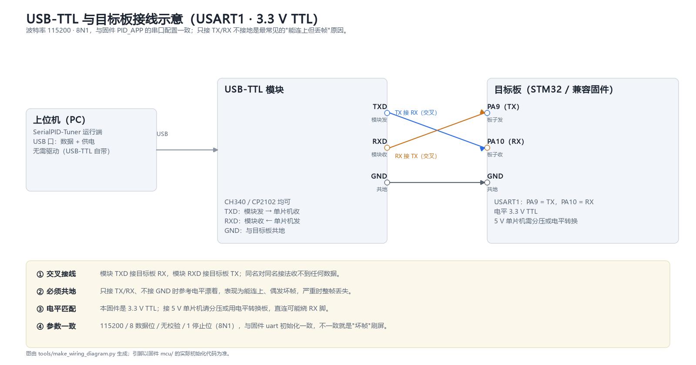

# 硬件接线与示例网表

> 本文件描述上位机 ↔ MCU 的串口接线，以及 MCU 侧控制回路的预留接口。
> 协议物理层参数（115200 8N1、3.3V TTL）见 [PROTOCOL.md](PROTOCOL.md)；
> 固件集成示例见 `mcu/Src/main_example.c`；
> **从上电到看到曲线的八步自测、CubeMX 配置对照、故障排查树与测量建议**见
> [bringup.md](bringup.md)。

## 1. 链路总览

```
┌──────────────┐   3.3V TTL UART    ┌──────────────────┐   USB   ┌────────────┐
│   STM32 MCU  │ ─────────────────▶ │  USB-TTL 转换器  │ ──────▶ │  PC 上位机  │
│  USART1      │ ◀───────────────── │  (CH340/CP2102/  │         │            │
│              │                     │   FT232)         │         │            │
└──────────────┘                     └──────────────────┘         └────────────┘
```

- 通信总线：UART，3.3V TTL 电平，115200 8N1，无流控。
- 上位机也可走 TCP 连接离线模拟器 `tools/fake_mcu.py`，该方式无需任何接线。

## 接线示意



看图的三个要点（下面表格与之一一对应）：

1. **交叉**：模块 TXD 接板子 RX、模块 RXD 接板子 TX，同名对同名接法一帧都收不到；
2. **共地**：GND 不接时参考电平悬空，表现为"能连上、偶发坏帧"，严重时整帧丢；
3. **电平**：固件按 3.3 V TTL 设计，接 5 V 单片机需分压或电平转换，直连可能烧 RX。

> 示意图由 `tools/make_wiring_diagram.py` 生成；改了引脚或电平口径，跑一次脚本图就跟着更新。

## 2. 串口接线表（USART1 示例）

下表为 STM32 典型 USART1 映射（F1/F4 常见 PA9=TX、PA10=RX）；**具体引脚以你的
CubeMX USART1 配置为准**，换用其它串口时对应替换即可。

| STM32 引脚 | 方向 | 接到 USB-TTL 引脚 | 说明 |
| --- | --- | --- | --- |
| USART1_TX（如 PA9） | 输出 → | TTL 转换器 **RXD** | MCU 发送 → 转换器接收，交叉连接 |
| USART1_RX（如 PA10） | 输入 ← | TTL 转换器 **TXD** | 转换器发送 → MCU 接收，交叉连接 |
| GND | 共地 | 转换器 **GND** | 必须连接，否则电平参考不一致、数据乱码 |
| 3.3V | 按需 | 转换器 **3V3 / VCC** | 仅当由 MCU 给转换器供电时接；不要把 5V 接进 MCU 引脚 |
| （可选）RX 上拉 | — | 3.3V 经 **10 kΩ** 到 RX | 仅当 RX 可能悬空（对方未驱动、热插拔、排线接触不良）时加；正常推挽驱动不需要 |

```
STM32 PA9 (TX)  ────────▶  转换器 RXD
STM32 PA10(RX)  ◀────────  转换器 TXD
STM32 GND       ─────────  转换器 GND
```

### 2.1 电平与供电注意

- STM32 IO 为 **3.3V** TTL，禁止直连 RS232 口（±12V 电平），也不要直连
  5V TTL 串口器件，必要时加电平转换。
- 转换器若标注 5V/3.3V 可选，拨到 **3.3V** 一侧。
- 上位机与 MCU 必须**共地**；只接 TX/RX 不接 GND 是最常见的乱码原因之一。
- 执行器 / 传感器电源与 MCU 电源分开供电时，两地之间仍需连一根共地线。
- 上电顺序：先接好线再上电；确认 TX/RX 不接反，避免 MCU 接收脚被灌电流。
- **5 V 器件不等于能直连**：F1/F4 的部分引脚是 FT（5 V 容忍），但 ADC/模拟输入脚
  （如 PA0）**不耐 5 V**，接 5 V 传感器前必须分压或加电平转换。

### 2.2 波特率容差与线长

UART 是异步逐位采样：收发双方的时钟偏差会在"起始位 + 8 数据位 + 停止位"这 10 位内累积，
累计超过半个位宽就开始采错。所以**总偏差必须小于 5%，工程上按 ≤2% 留余量**。

| 误差来源 | 典型值 | 说明 |
| --- | --- | --- |
| MCU 内部 RC（HSI） | 常温 ±1%，全温可达 ±2.5% | 不接外部晶振时用的时钟，随温度漂 |
| MCU 外部晶振（HSE） | ±20~50 ppm | 推荐，8 MHz |
| USB-TTL 转换器 | ±0.3%~1% | 低成本 CH340 模块常见 |
| 叠加 | HSI + 一般转换器 ≈ 3% 以上 | 常温能通，高温/长时间运行后偶发帧错误 |

结论：**115200 要长期可靠，用外部晶振**；只有 HSI 时把波特率降到 9600/19200 更稳。
"跑一会儿开始丢帧、重启就好"这类现象，先怀疑时钟偏差，不要先怀疑线。

| 线长 | 做法 |
| --- | --- |
| ≤30 cm 杜邦线 | 直连即可，GND 单独一根，别和电源线并在一起 |
| 30~100 cm | 信号线与 GND 双绞，远离电机、继电器、开关电源 |
| 1~2 m | 用屏蔽线并接屏蔽层到 GND，同时降低波特率 |
| >2 m | 改 RS-485 / 差分传输，不要用 TTL 单端硬拉 |

115200 下位宽 8.68 µs，边沿本身不是瓶颈；长线的问题是**地弹与串扰**，
现象是偶发 CRC 错误而不是成片乱码（成片乱码通常是波特率或电平问题）。

## 3. 控制回路预留接口

上位机只观测曲线、下发参数，**闭环 PID 运算在 MCU 内完成**。固件示例预留了
两路 BSP 接口（`main_example.c`）：

| 回路 | MCU 外设（示例） | 方向 | 接到对象 |
| --- | --- | --- | --- |
| 执行器输出 | TIM3 PWM（示例 CH1，ARR=999，1kHz） | MCU → 驱动电路 | 加热丝 / 电机 / 半桥 / 继电器等 |
| 被控量反馈 | ADC 采样 | 传感器 → MCU | 温度 / 转速 / 位置 / 液位等传感器 |

### 3.1 输出通路（`bsp_write_output`）

- 输入为 0–100% 的归一化输出，应用层已限幅；BSP 层再兜一层 0–100% 限幅。
- PWM 实现：`CCR = round(out_percent × (ARR+1) / 100)`，ARR=999 → CCR 0..1000
  （CCR > ARR 即 100% 恒高）。
- 驱动加热丝 / 半桥时，在 BSP 层处理极性（低有效驱动要取反）、死区与安全上限；
  感性负载注意续流。

### 3.2 反馈通路（`bsp_read_pv`）

- 每次控制周期做一次 ADC 单次转换（`HAL_ADC_Start` → 轮询 → `GetValue` → `Stop`），
  而不是连续转换：返回值本身就是健康信号，超时/启动失败时返回 `NaN`，
  应用层会保持上次输出。
- 原始值 → 物理量用 `PID_EXAMPLE_PV_SCALE` / `PID_EXAMPLE_PV_OFFSET` 线性标定，
  默认值只是占位（0..4095 → 0..100），接真实传感器必须替换。
- 建议加一阶低通滤波抑制采样噪声；传感器量程要覆盖工作区间，否则阶跃指标与
  稳态误差会被削顶失真。

### 3.3 两种 IO 模式：仿真对象 / 真实硬件

`main_example.c` 用编译宏 `PID_DEMO_SIMULATED_PLANT` 把两套 BSP 实现分开，
**没有运行时开关**（故意如此：有开关就会出现"以为接了硬件、其实还在跑模型"的错觉）。

| 模式 | 宏值 | `bsp_write_output` | `bsp_read_pv` | 适用 |
| --- | --- | --- | --- | --- |
| 仿真 | `1`（默认） | 只写内存变量 `g_sim_out`，不驱动引脚 | 一阶惯性模型 K=0.45 / T=8 s | 无硬件时联调上位机、跑协议、看曲线 |
| 真实 IO | `0` | TIM3_CH1 PWM，`CCR = out% × (ARR+1)/100` | ADC1 单次转换 + 线性标定 | 接真实传感器与执行器 |

切换方法：改宏 → 重新编译烧录（真实模式还要求 CubeMX 里配好 TIM3_CH1 与 ADC1，
配置对照见 [bringup.md](bringup.md) §2）。

**怎么确认板子里烧的是哪一种**：断开执行器给 20% 输出，若 PV 按 8 s 时间常数平滑爬向 9
且没有噪声 → 还是仿真；测 PWM 引脚，仿真模式恒低、真实模式有 1 kHz 方波。
完整判据见 [bringup.md](bringup.md) §1。

真实模式的两个实现要点：

- 输出：先限幅 0–100%，再换算成 CCR；低有效驱动（PNP / 低电平触发 SSR）要在
  `bsp_write_output` 里取反，并确认上电瞬间为"关"。半桥/推挽的死区不在这层处理。
- 反馈：ADC 单次转换 + 轮询，启动失败或转换超时返回 `NaN`，应用层会保持上次输出。
  `PID_EXAMPLE_PV_SCALE` / `PID_EXAMPLE_PV_OFFSET` 默认只是占位标定
  （0..4095 → 0..100），**接真实传感器必须替换**，否则曲线好看但数值是假的。

## 4. 建议物料（BOM）

| 类别 | 物料 | 备注 |
| --- | --- | --- |
| 主控 | STM32 开发板（F103 / F4 等） | 按固件工程与外设资源选择 |
| 串口转换器 | CH340 / CP2102 / FT232，3.3V 电平 | 带 3.3V 电平选择更佳 |
| 连线 | 杜邦线 / 排针若干 | TX-RX 交叉、GND 共地 |
| 被控对象 | 加热体 / 电机 / 水泵 / 温度箱等 | 按整定目标选择 |
| 驱动 | MOS 管 / 半桥 / 继电器 / 固态继电器 | 与执行器电压电流匹配 |
| 反馈传感器 | 温度 / 转速 / 位置 / 液位传感器 | 输出经调理后可接 ADC |
| 电源 | MCU 电源 + 执行器电源 | 功率回路与逻辑回路分开，共地 |

## 5. 接线核对表（按顺序逐项核对）

前 6 项是物理层，做错任何一项都表现为"连不上/乱码"，且元件本身没坏——
所以必须逐项核对，不要靠"换根线试试"。

| # | 核对项 | 要求 | 不符时的典型现象 |
| --- | --- | --- | --- |
| 1 | 电平 | 3.3 V TTL；5 V 器件必须经电平转换；ADC/模拟脚绝不接 5 V | 收不到数据，或引脚发热/损坏 |
| 2 | 共地 | MCU、转换器、执行器电源三处 GND 连在一起（含功率地与逻辑地） | 乱码、CRC 大量报错、示波器上电平"浮"在 1.5 V |
| 3 | 交叉 | MCU TX → 转换器 RXD；转换器 TXD → MCU RX | 完全无数据，或只能单向（能发不能收） |
| 4 | 上拉 | RX 可能悬空（对方未驱动、热插拔、排线虚接）时加 10 kΩ 到 3.3 V | 空闲时收到随机噪声帧，连接后偶发 ERROR |
| 5 | 波特率容差 | 双方总偏差 ≤2%（用外部晶振；只用 HSI 时降到 9600） | 常温能通、跑一会儿或升温后开始丢帧 |
| 6 | 线长 | ≤30 cm 杜邦线；更长按 2.2 节换成双绞/屏蔽/差分 | 偶发 CRC 错，电机启动时集中出现 |
| 7 | 接线顺序 | 先接线后上电；TX/RX 确认不接反 | MCU 接收脚被灌电流 |
| 8 | 固件接收 | USART1 全局中断已开；错误回调里 Abort + 重挂接收 | 能发不能收，上位机侧像设备掉线 |
| 9 | 执行器驱动 | 驱动供电与逻辑供电分开、共地；感性负载有续流 | 参数下发正常但对象不动，或复位重启 |
| 10 | 模拟输入 | ADC 引脚配 Analog 模式，采样时间与源阻抗匹配 | PV 偏低、随通道漂移 |
| 11 | 先软后硬 | 先用 TCP 模拟器（127.0.0.1:9000）确认上位机链路正常，再接实物串口 | 分不清问题在上位机还是硬件 |
| 12 | 编译回归 | 改过 HAL 示例后跑 `scripts/verify_mcu_build.ps1`（见第 7 节） | 示例编不过、或真实 IO 分支从来没被编译过 |

## 6. 常见接线问题

| 现象 | 可能原因 | 处理 |
| --- | --- | --- |
| 连接后完全无数据 | TX/RX 接反；GND 未接；串口号 / 波特率错误 | 交叉互换 TX/RX；补共地；核对端口与波特率 |
| 收到乱码字节 | 波特率不一致；电平不匹配；共地不良；线过长 | 统一 115200；换 3.3V 转换器；补共地；缩短杜邦线 |
| 能下发、收不到回包 | 固件未开接收中断；接收被 ORE 打断；RX 未接 | 检查中断与错误回调；核对 RX 接线 |
| 曲线削顶 / 饱和 | 传感器量程不足或输出限幅 | 标定量程；检查执行器与驱动上限 |
| 模拟器正常、实物不通 | 只验了 TCP，串口硬件链路未通 | 按第 5 节清单逐项排查 |

上表只覆盖接线层面；固件配置与协议层面的六类问题（无数据 / 乱码 / 参数不生效 /
复位丢参数 / 抖动大 / 阶跃无响应）按"先查→再查→最后查"三层排查，见
[bringup.md](bringup.md) §6。

## 7. HAL 集成示例：符号清单与编译验证

两份示例（`mcu/Src/main_example.c`、`mcu/Src/pid_nvm_stm32_example.c`）**不是**库的一部分，
它们是"照抄进 CubeMX 工程"的接线图。也正因如此，它们以前不在仓库的编译验证范围里——
一旦 HAL 宏改名、函数签名变化，用户照抄时会卡在编译错误上，还以为是自己的工程配置坏了。
本节把这件事闭合：示例进入每次回归的 ARM 编译验证，并把"需要哪些 HAL 符号"列清楚。

### 7.1 一份示例、两种编译环境

| 环境 | 头文件来源 | 怎么触发 |
| --- | --- | --- |
| 你的 CubeMX 工程 | CubeMX 生成的 `main.h`（内含真实 HAL） | 什么都不用定义，粘进去即可 |
| 本仓库回归 | `mcu/stubs/stm32_hal_stub.h`（**只有声明与类型，没有实现**） | 脚本传 `-DPID_HAL_STUB=1` |

文件头里有三态宏 `PID_HAL_STUB`：不定义=自动探测（有 `main.h` 就用真实的，没有就用桩），
`1`=强制桩，`0`=强制真实 HAL。桩环境**只用于编译**，不能链接、不能运行——它刻意不提供任何
函数体，就是为了避免"示例看起来跑通了"的错觉。

### 7.2 逐项核对清单（对着你的 CubeMX 工程勾）

| 符号 | 类别 | 示例中的用途 |
| --- | --- | --- |
| `USART1` | 实例宏 | 判断 `huart->Instance` 是哪个串口 |
| `UART_HandleTypeDef` / `TIM_HandleTypeDef` | 类型 | 外设句柄 |
| `HAL_UART_Transmit` | 函数 | BSP 发帧（轮询，20ms 超时） |
| `HAL_UART_Receive_IT` | 函数 | 挂 1 字节接收中断 |
| `HAL_UART_AbortReceive_IT` | 函数 | 错误回调里打断接收状态机后重挂 |
| `__HAL_UART_CLEAR_OREFLAG` / `NEFLAG` / `FEFLAG` | 宏 | 清溢出/噪声/帧错误标志 |
| `HAL_GetTick` | 函数 | **默认毫秒时基**（SysTick） |
| `TIM6` + `HAL_TIM_Base_Start_IT` | 实例宏 / 函数 | 仅 `PID_EXAMPLE_USE_TIM6=1` 时需要 |
| `TIM_CHANNEL_1` + `HAL_TIM_PWM_Start` | 宏 / 函数 | 真实 IO 分支启动 PWM 通道 |
| `__HAL_TIM_SET_COMPARE` | 宏 | 真实 IO 分支写占空比（CCR） |
| `ADC1` / `ADC_HandleTypeDef` / `hadc1` | 实例宏 / 类型 / 全局句柄 | 真实 IO 分支读测量值 |
| `HAL_ADC_Start` / `HAL_ADC_PollForConversion` / `HAL_ADC_GetValue` / `HAL_ADC_Stop` | 函数 | 单次转换 + 轮询，超时返回 NaN |
| `MX_ADC1_Init` | 函数 | 真实 IO 分支在 `main` 里调用 |
| `HAL_FLASH_Unlock` / `Lock` | 函数 | NVM 擦写临界区 |
| `HAL_FLASHEx_Erase` + `FLASH_EraseInitTypeDef` | 函数 / 类型 | 擦页（F1）或擦扇区（F4/H7） |
| `HAL_FLASH_Program` | 函数 | 写半字 / 字 / 32 字节 flashword |
| `HAL_FLASH_Unlock` 相关 `FLASH_FLAG_*` | 宏 | 擦之前清错误标志 |
| `MX_USART1_UART_Init` / `MX_GPIO_Init` / `MX_TIM6_Init` / `MX_TIM3_Init` / `SystemClock_Config` / `Error_Handler` | 函数 | CubeMX 生成的初始化入口（示例只调用，不定义） |

> 说明：`MX_TIM6_Init` 只有在你启用 TIM6 时基时才需要（默认走 SysTick 的版本不需要，
> F103C8 也没有 TIM6）；`MX_TIM3_Init` / `MX_ADC1_Init` 只在真实 IO 模式
> （`PID_DEMO_SIMULATED_PLANT=0`）里调用，仿真模式不需要这两个外设——这样"只跑仿真"
> 的工程不会因为少配一个 ADC 就编不过。

### 7.3 三族差异（示例里的分支就是按这张表选的）

| 项目 | F1 / F0 / L0 | F4 / F3 | H7 |
| --- | --- | --- | --- |
| 编程单位宏 | `FLASH_TYPEPROGRAM_HALFWORD` | `FLASH_TYPEPROGRAM_WORD` | `FLASH_TYPEPROGRAM_FLASHWORD` |
| 擦除方式 | `FLASH_TYPEERASE_PAGES`（页） | `FLASH_TYPEERASE_SECTORS`（扇区）+ `FLASH_VOLTAGE_RANGE_3` | `FLASH_TYPEERASE_SECTORS` + `Banks` |
| 写保护错误标志 | `FLASH_FLAG_WRPERR`（寄存器位叫 `SR_WRPRTERR`，HAL 宏不叫 `WRPRTERR`） | `FLASH_FLAG_WRPERR` | `FLASH_FLAG_ALL_ERRORS` |
| 示例默认存放区 | `0x0801FC00`（末页 1KB） | `0x080E0000`（Sector 11） | `0x081E0000`（Sector 7 Bank2） |
| 1ms 硬件定时器 | F103C8 只有 TIM1~TIM4，**没有 TIM6** | TIM6 可用 | TIM6 可用 |

分支判据按"擦除单位"选族（`FLASH_TYPEERASE_PAGES` → F1；`FLASH_TYPEERASE_SECTORS` +
`FLASH_TYPEPROGRAM_WORD` → F4；`FLASH_TYPEPROGRAM_FLASHWORD` → H7）。**不要**用
`FLASH_TYPEPROGRAM_HALFWORD` 当判据：F4 也定义了这个宏，会把 F4 误判成 F1，编不过。

### 7.4 验证矩阵（本轮实测，脚本共 20 项）

| 构建项 | 编译器参数 | 结果 |
| --- | --- | --- |
| 核心三模块 `pid_comm` / `pid_calc` / `pid_app` | `cortex-m4 -mthumb -O2 -Wall -Wextra` | 通过，零告警 |
| `main_example.c` × 桩 F1/F4/H7（仿真分支） | `cortex-m3/m4/m7 -O2 -Wall -Wextra` | 通过，零告警 |
| `pid_nvm_stm32_example.c` × 桩 F1/F4/H7 | 同上 | 通过，零告警 |
| `main_example.c`（`PID_EXAMPLE_USE_TIM6=1` 分支） | `cortex-m3` 桩 | 通过，零告警 |
| `main_example.c`（**真实 IO 分支**，`PID_DEMO_SIMULATED_PLANT=0`）× 桩 F1/F4/H7 | 同上 | 通过，零告警 |
| `main_example.c` / `pid_nvm_stm32_example.c` | **真实 F1 HAL**（STM32Cube_FW_F1_V1.8.7，`STM32F103xB`） | 通过，零告警 |
| `main_example.c` / `pid_nvm_stm32_example.c` | **真实 F4 HAL**（STM32Cube_FW_F4_V1.28.3，`STM32F407xx`） | 通过，零告警 |
| `main_example.c`（`PID_EXAMPLE_USE_TIM6=1` 分支） | 真实 F4 HAL | 通过，零告警 |
| `main_example.c`（**真实 IO 分支**） | 真实 F1 / F4 HAL | 通过，零告警 |
| 真实 H7 HAL | 本机无 STM32Cube_FW_H7 包 | **未验证**：只有桩级别的语法/类型检查 |
| 上板实跑（擦写 Flash、UART 中断、PWM、ADC） | — | **未验证**：无实物板，属硬件待验项 |

**诚实边界**：桩验证能拦住语法、类型、宏改名、函数签名漂移；拦不住"型号相关的运行时行为"——
Flash 扇区大小、电压范围、时序、中断优先级、ADC 采样时间这些仍要上板确认。
H7 分支的 API 用法按公开头文件写，但本机没有 H7 的 Cube 包，没有做过真实 HAL 对照，
属于"桩验证、未上板、未对真实头文件"的三重空白。
真实 IO 分支（PWM/ADC）**只证明了能编过**，没有一条在硅片上跑过——
上板验证步骤见 [bringup.md](bringup.md) 第 3 节。

### 7.5 这一轮编译验证抓出来的问题（已修）

| 问题 | 后果 | 修法 |
| --- | --- | --- |
| F4 也定义 `FLASH_TYPEPROGRAM_HALFWORD`，示例按该宏选分支 | **F4 走到 F1 分支**，`FLASH_FLAG_PGERR` / `FLASH_TYPEERASE_PAGES` 在 F4 未定义 → 真实 F4 HAL 下编不过 | 分支判据改为按擦除单位（见 7.3） |
| 示例写死 TIM6 做毫秒时基 | **F103C8（示例点名的芯片）没有 TIM6** → 目标芯片上编不过 | 默认改用 SysTick（`HAL_GetTick`），TIM6 变成可选开关 |
| F1 侧写了 `FLASH_FLAG_WRPRTERR` | 真实 F1 HAL 的宏叫 `FLASH_FLAG_WRPERR` → 编不过 | 统一改成 `FLASH_FLAG_WRPERR` |
| 真实 IO 分支（`PID_DEMO_SIMULATED_PLANT=0`）从来没有对应的构建项 | "上板用的那半边代码"从未被编译；PWM/ADC 写错了也测不出来 | 脚本新增真实 IO 分支 × 桩 F1/F4/H7 + 真实 F1/F4，共 5 项 |
| 交叉验证用的 HAL 配置漏开 `HAL_ADC_MODULE_ENABLED` | 真实 HAL 下 `ADC_HandleTypeDef` 未定义、`HAL_ADC_Start` 变成隐式声明 → 新增的真实 IO 构建立刻失败 | 两份 `*_hal_conf.h` 打开 ADC 模块并包含 `*_hal_adc.h` |

### 7.6 怎么跑

```powershell
# 仓库根目录；需要 Arm GNU Toolchain（arm-none-eabi-gcc）在 PATH 里
pwsh scripts/verify_mcu_build.ps1

# 机器上没有 STM32Cube 包时（只用桩，仍然严格执行零告警）
pwsh scripts/verify_mcu_build.ps1 -SkipRealHal
```

脚本会：编译核心三模块 → 两份示例 × 三族（桩）→ TIM6 可选分支 → **真实 IO 分支 × 三族（桩）**
→ 找到 Cube 包再对真实 HAL 编一遍（含真实 IO 分支）；
任何一项非零退出或**本仓源码**出现告警即返回 1（vendor 头文件自身的告警不记账）。

